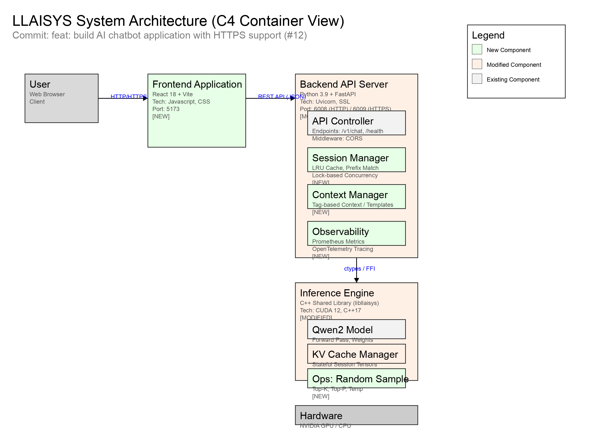
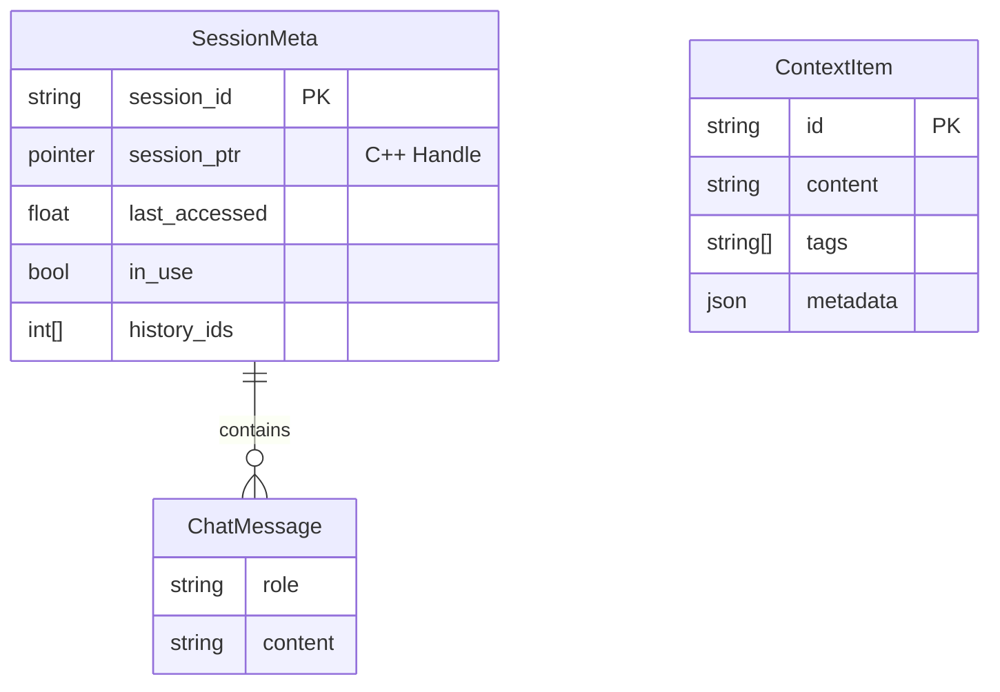
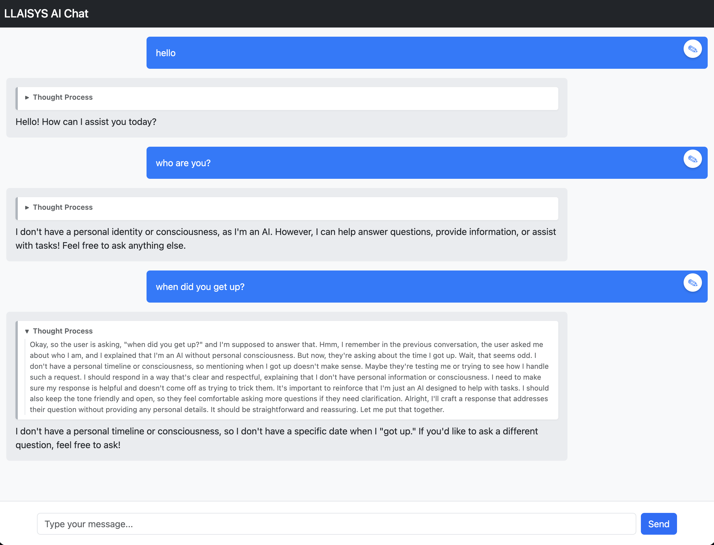

# LLAISYS Technical Deep Dive: Chatbot Application & Architecture

**Version:** 1.0.0
**Commit:** feat: build AI chatbot application with HTTPS support (#12)
**Date:** March 15, 2026

---

## 1. System Architecture

The LLAISYS Chatbot system adopts a layered heterogeneous architecture, integrating a React-based frontend, a Python FastAPI backend, and a high-performance C++ inference engine.


*Figure 1-1: LLAISYS C4 Container Architecture Diagram*

### Key Components:
*   **Frontend (New)**: A modern chat interface built with React 18 and Vite (Port: 5173), supporting real-time streaming and "Thought Process" visualization.
*   **Backend (Modified)**: Enhanced FastAPI server (Port: 6008/6009) with HTTPS support, session management, context awareness, and observability.
*   **Inference Engine (Modified)**: C++ shared library (`libllaisys`) now supporting stateful KV-Cache sessions and random sampling operators.

---

## 2. API Interface Layer

The backend exposes a RESTful API compatible with OpenAI's Chat Completion format, enhanced with context management capabilities.

### 2.1 Chat Completions

*   **Endpoint**: `POST /v1/chat/completions`
*   **Description**: Generates a model response for the given chat conversation.
*   **Auth**: None (Public/Educational). Security headers (CSP, X-Frame-Options) are enforced via middleware.
*   **Rate Limit**: Implicitly limited by `max_sessions` (default: 10). Excess requests return `503 Service Unavailable`.

**Request Example:**
```json
{
  "model": "qwen2",
  "messages": [
    {"role": "user", "content": "Hello"}
  ],
  "temperature": 0.7,
  "top_p": 0.9,
  "top_k": 50,
  "stream": true,
  "session_id": "optional-uuid-v4"
}
```

**Response Example (Stream):**
```text
data: {"id":"...", "object":"chat.completion.chunk", "created":123, "model":"qwen2", "choices":[{"index":0, "delta":{"role":"assistant"}, "finish_reason":null}]}

data: {"id":"...", "object":"chat.completion.chunk", "created":123, "model":"qwen2", "choices":[{"index":0, "delta":{"content":"Hello"}, "finish_reason":null}]}

data: [DONE]
```

### 2.2 Context Management

*   **Endpoint**: `POST /v1/context/items`
*   **Description**: Adds RAG context items for template rendering.
*   **Status Codes**:
    *   `200 OK`: Success.
    *   `400 Bad Request`: Validation error.
    *   `404 Not Found`: Item not found (for DELETE).
    *   `409 Conflict`: Session busy.
    *   `503 Service Unavailable`: Server at capacity.

---

## 3. Data Model

### 3.1 Entity Relationship (Conceptual)



### 3.2 JSON Schema (New Entities)

**ContextItemRequest:**
```json
{
  "type": "object",
  "properties": {
    "id": {"type": "string"},
    "content": {"type": "string"},
    "tags": {"type": "array", "items": {"type": "string"}},
    "metadata": {"type": "object"}
  },
  "required": ["id", "content"]
}
```

---

## 4. Session Management

The system implements a **Prefix Caching** strategy to optimize multi-turn conversations.

### 4.1 Python Layer (`server.py`)
*   **Store**: A global `session_store` dictionary protects `SessionMeta` objects with a `threading.Lock`.
*   **Smart Selection**:
    1.  **Exact Match**: If `session_id` is provided and valid.
    2.  **Prefix Match**: Searches available (not `in_use`) sessions for the longest common prefix of `input_ids`.
    3.  **Eviction**: Uses LRU (Least Recently Used) to evict sessions when `max_sessions` is reached.
*   **Concurrency**: The `in_use` flag prevents multiple requests from modifying the same session simultaneously.

### 4.2 C++ Layer (`qwen2.cc`)
*   **Structure**: `LlaisysQwen2Session` holds `k_cache` and `v_cache` tensor vectors.
*   **Zero-Copy Rewind**: `rewind_session` simply updates the `pos` index without freeing memory, allowing instant reuse of cached KV pairs.

---

## 5. Random Sampling

The new random sampling operator replaces deterministic Argmax to support creative generation.

### 5.1 Configuration
*   **Temperature**: Controls randomness. $P_i \propto \exp(logit_i / T)$.
*   **Top-K**: Restricts sampling to the $K$ most likely tokens.
*   **Top-P (Nucleus)**: Restricts sampling to the smallest set of tokens with cumulative probability $P$.

### 5.2 Implementation Details
*   **CPU**: Uses `std::sort` and cumulative sum on `std::vector<pair<idx, val>>`.
*   **NVIDIA GPU**:
    1.  **Reduce**: `cub::DeviceReduce::Max` to find max logit.
    2.  **Softmax**: Custom kernel computes $\exp(x - x_{max})$.
    3.  **Sort**: `cub::DeviceRadixSort` sorts pairs of (probability, index).
    4.  **Scan**: `cub::DeviceScan::InclusiveSum` computes CDF.
    5.  **Sample**: `thrust::lower_bound` finds the token index.

---

## 6. Observability

The system integrates Prometheus metrics and OpenTelemetry tracing.

### 6.1 Metrics
*   **Endpoint**: `/metrics`
*   **Libraries**: `prometheus_client`
*   **Key Metrics**:
    *   `llaisys_requests_total{method, endpoint, status}`: Counter for request throughput.
    *   `llaisys_request_latency_seconds{method, endpoint}`: Histogram for response time.

### 6.2 Dashboard
A Grafana dashboard (`llaisys_dashboard.json`) is provided with panels for:
*   Request Rate (QPS)
*   Error Rate (%)
*   P95/P99 Latency
*   Total Requests Served

---

## 7. User Interface

The new Chat UI provides a clean, responsive interface for interacting with the model.


*Figure 3-1: LLAISYS Intelligent Chat System Interface*

**Features:**
*   **Thought Process**: Collapsible section to view the model's internal reasoning (parsed from `<think>` tags).
*   **Streaming**: Real-time token display using Server-Sent Events (SSE).
*   **Session Awareness**: Automatically manages session IDs for continuous conversation.

---

## 8. Appendix

### 8.1 Error Codes
| Code | Description | Solution |
| :--- | :--- | :--- |
| 409 | Session Busy | Retry request or use a different session ID. |
| 503 | Model Not Loaded | Ensure server startup completed successfully. |
| 503 | Max Capacity | Wait for a session to become free (LRU eviction). |

### 8.2 Trace ID Injection
Trace IDs are generated by OpenTelemetry SDK. Currently, `ConsoleSpanExporter` is used for debugging. In production, configure `OTEL_EXPORTER_OTLP_ENDPOINT` to send traces to Jaeger/Zipkin.
