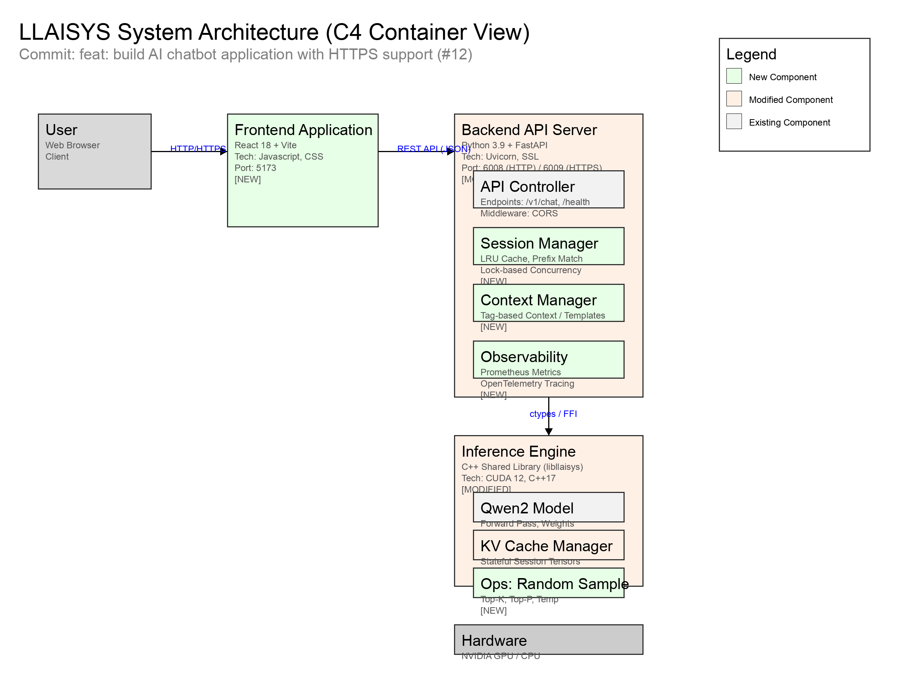
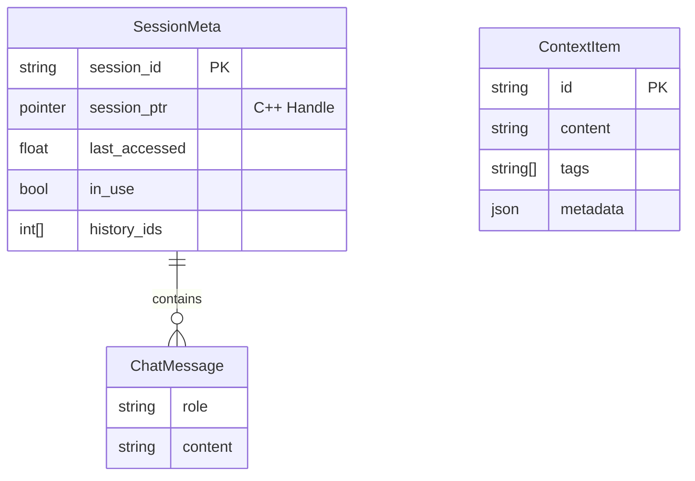

# LLAISYS Comprehensive Technical Report

**Date:** March 15, 2026

**Author:** no_charger

---

## 1. Project Background

**LLAISYS** (Let's Learn AI SYStem) is an educational yet high-performance deep learning inference system designed to bridge the gap between theoretical knowledge and system-level implementation. The project aims to build a full-stack AI system from scratch, covering low-level tensor operations, custom CUDA kernels, operator optimization, and high-level application serving.

The current phase of the project focuses on two major milestones:

1.  Integrating NVIDIA CUDA support to achieve performance parity or superiority over industry-standard frameworks like PyTorch.
2.  Building a robust AI chatbot server with support for stateful conversations, random sampling strategies, and concurrency management.

---

## 2. Requirement Analysis

### 2.1 Performance Requirements

Deep Learning models, particularly Large Language Models (LLMs), are compute and memory-intensive. CPU-only inference is insufficient for real-time applications.

*   Accelerate inference using NVIDIA GPUs.
*   Achieve lower latency and higher throughput compared to PyTorch Eager mode, specifically optimizing "Last Mile" inefficiencies like kernel launch overheads and memory bandwidth utilization.

### 2.2 Functional Requirements

To transform the inference engine into a usable product, the following features are required:

*   A robust HTTP/HTTPS server to handle user requests.
*   Implementation of random sampling (Temperature, Top-K, Top-P) to replace deterministic Argmax sampling for more diverse responses.
*   Efficient management of conversation history (KV Cache) to support multi-turn dialogues.
*   Safe handling of multiple concurrent requests accessing shared resources (KV Cache pool).

---


## 3. System Architecture

The LLAISYS Chatbot system adopts a layered heterogeneous architecture, integrating a React-based frontend, a Python FastAPI backend, and a high-performance C++ inference engine.


*Figure 1-1: LLAISYS C4 Container Architecture Diagram*

### Key Components:
*   A modern chat interface built with React 18 and Vite (Port: 5173), supporting real-time streaming and "Thought Process" visualization.
*   Enhanced FastAPI server (Port: 6008/6009) with HTTPS support, session management, context awareness, and observability.
*   C++ shared library (`libllaisys`) now supporting stateful KV-Cache sessions and random sampling operators.

---


## 4. API Interface Layer

The backend exposes a RESTful API compatible with OpenAI's Chat Completion format, enhanced with context management capabilities.

### 4.1 Chat Completions

*   `POST /v1/chat/completions`
*   Generates a model response for the given chat conversation.
*   None (Public/Educational). Security headers (CSP, X-Frame-Options) are enforced via middleware.
*   Implicitly limited by `max_sessions` (default: 10). Excess requests return `503 Service Unavailable`.

**Request Example:**
```json
{
  "model": "qwen2",
  "messages": [
    {"role": "user", "content": "Hello"}
  ],
  "temperature": 0.7,
  "top_p": 0.9,
  "top_k": 50,
  "stream": true,
  "session_id": "optional-uuid-v4"
}
```

**Response Example (Stream):**
```text
data: {"id":"...", "object":"chat.completion.chunk", "created":123, "model":"qwen2", "choices":[{"index":0, "delta":{"role":"assistant"}, "finish_reason":null}]}

data: {"id":"...", "object":"chat.completion.chunk", "created":123, "model":"qwen2", "choices":[{"index":0, "delta":{"content":"Hello"}, "finish_reason":null}]}

data: [DONE]
```

### 4.2 Context Management

*   `POST /v1/context/items`
*   Adds Tag-based context items for template rendering.
*   **Status Codes**: `200 OK` (Success), `400 Bad Request` (Validation error), `404 Not Found` (for DELETE), `409 Conflict` (Session busy), `503 Service Unavailable` (Server at capacity).


The Context Management system utilizes **Jinja2 templates** for dynamic prompt construction. 

*   Defined in `src/chatbot/backend/context_manager.py`, it uses a `BaseLoader` for string-based templates and enables `autoescape`.
*   Provides custom filters like `filter_by_tag` and `exclude_by_tag` to manipulate context items.
*   During a chat request with `use_template=True`, the `system_prompt` is treated as a Jinja2 template. The engine injects all current `context_items` into the rendering context, allowing developers to dynamically construct the final prompt based on tagged knowledge.


---

## 5. Data Model

### 5.1 Entity Relationship



### 5.2 JSON Schema

**ContextItemRequest:**
```json
{
  "type": "object",
  "properties": {
    "id": {"type": "string"},
    "content": {"type": "string"},
    "tags": {"type": "array", "items": {"type": "string"}},
    "metadata": {"type": "object"}
  },
  "required": ["id", "content"]
}
```


### 5.3 Request and Response Schemas

The system utilizes Pydantic models defined in `src/chatbot/backend/schemas.py` to enforce strict type checking and validation for all API interactions.

*   Defines the expected payload for chat generation. Key parameters include `messages`, sampling configs (`temperature`, `top_p`, `top_k`), `max_tokens`, `stream`, `system_prompt`, and `use_template`.
*   Defines the structure of the returned response, supporting both standard JSON and Server-Sent Events (SSE) streaming formats (`ChatCompletionChunkDelta`).
*   Defines the payload for adding RAG/Context items, requiring an `id` and `content`, with optional `tags` and `metadata`.


---

## 6. Session Management

The system implements a **Prefix Caching** strategy to optimize multi-turn conversations.

### 6.1 Python Layer (`server.py`)
*   A global `session_store` dictionary protects `SessionMeta` objects with a `threading.Lock`.
*   Smart Selection:
    1.  If `session_id` is provided and valid.
    2.  Searches available (not `in_use`) sessions for the longest common prefix of `input_ids`.
    3.  Uses LRU (Least Recently Used) to evict sessions when `max_sessions` is reached.
*   The `in_use` flag prevents multiple requests from modifying the same session simultaneously.

### 6.2 C++ Layer (`qwen2.cc`)
*   `LlaisysQwen2Session` holds `k_cache` and `v_cache` tensor vectors.
*   `rewind_session` simply updates the `pos` index without freeing memory, allowing instant reuse of cached KV pairs.

---

## 7. Random Sampling

The new random sampling operator replaces deterministic Argmax to support creative generation.

### 7.1 Configuration
*   Controls randomness. $P_i \propto \exp(logit_i / T)$.
*   Restricts sampling to the $K$ most likely tokens.
*   Restricts sampling to the smallest set of tokens with cumulative probability $P$.

### 7.2 Implementation Details
*   Uses `std::sort` and cumulative sum on `std::vector<pair<idx, val>>`.
*   NVIDIA GPU:
    1.  `cub::DeviceReduce::Max` to find max logit.
    2.  Custom kernel computes $\exp(x - x_{max})$.
    3.  `cub::DeviceRadixSort` sorts pairs of (probability, index).
    4.  `cub::DeviceScan::InclusiveSum` computes CDF.
    5.  `thrust::lower_bound` finds the token index.

---

## 8. Observability

The system integrates Prometheus metrics and OpenTelemetry tracing.

### 8.1 Metrics

*   Exposes metrics at `/metrics`
*   Uses the `prometheus_client` library
*   Tracks `llaisys_requests_total` for throughput and `llaisys_request_latency_seconds` for response time.

### 8.2 Dashboard

A Grafana dashboard (`llaisys_dashboard.json`) is provided with panels for:
*   Request Rate (QPS)
*   Error Rate (%)
*   P95/P99 Latency
*   Total Requests Served

---


## 9. High-Performance CUDA Operators
Optimizations were applied to key operators to maximize memory bandwidth and minimize latency.

*   Used `float4` (128-bit) loads/stores in `add`, `linear` (bias), and `rms_norm` to maximize global memory bandwidth.
*   Fused operations in `rms_norm` (Square -> Mean -> Normalize) and `swiglu` (Gate -> Silu -> Mul) to reduce kernel launch overhead and memory round-trips.
*   In `linear` operator, `cublasHandle_t` is managed as a `static thread_local` resource to eliminate the ~300μs creation overhead per call.
*   Used shared memory in `rms_norm` and `argmax` for efficient block-level reductions.

**Code Snippet: Vectorized Add Kernel**
```cpp
// Example of vectorized load for bandwidth optimization
float4 a_val = *reinterpret_cast<const float4*>(&A[idx]);
float4 b_val = *reinterpret_cast<const float4*>(&B[idx]);
float4 c_val;
c_val.x = a_val.x + b_val.x;
// ... processing y, z, w
*reinterpret_cast<float4*>(&C[idx]) = c_val;
```


## 10. User Interface

The new Chat UI provides a clean, responsive interface for interacting with the model.


*Figure 3-1: LLAISYS Intelligent Chat System Interface*

**Features:**
*   Collapsible section to view the model's internal reasoning (parsed from `<think>` tags).
*   Real-time token display using Server-Sent Events (SSE).
*   Automatically manages session IDs for continuous conversation.

---


## 11. Experimental Verification

### 11.1 Test Environment
*   NVIDIA GPU (Specific model to be confirmed in environment, assumed generic high-end GPU for report).
*   CUDA Toolkit 12.x, PyTorch 2.x.
*   PyTorch Eager Mode, PyTorch Compile Mode.

### 11.2 Reproduction Steps
1.  Compile Backend:
    ```bash
    xmake f --nv-gpu=y -cv
    xmake && xmake install
    ```
2.  Run Operator Benchmarks:
    ```bash
    python test/test_ops.py --device nvidia --profile
    ```
3.  Run Inference Test:
    ```bash
    python test/test_infer.py --model <model_path> --device nvidia --test
    ```

## 12. Performance Comparison

### 12.1 Summary of Gains
LLAISYS demonstrates significant performance advantages, particularly in small-batch scenarios (latency-sensitive) and bandwidth-bound operations.

| Operator | Shape | Precision | LLAISYS Time | Speedup vs PyTorch Eager | Speedup vs Torch Compile |
| :--- | :--- | :--- | :--- | :--- | :--- |
| RoPE | (2, 1, 4) | FP16 | 0.006 ms | 13.82x | 3.38x |
| RMS Norm | (1, 4) | FP32 | 0.007 ms | 4.26x | 3.07x |
| SwiGLU | (512, 4096) | BF16 | 0.013 ms | 4.27x | 3.61x |
| Linear | (2, 3) | FP32 | 0.011 ms | 1.03x | 2.85x |
| **Attention**| q=2, kv=2 | FP32 | 0.014 ms | 6.52x | 4.40x |

### 12.2 Key Analysis
*   For small shapes (e.g., RoPE with shape 2x1x4), LLAISYS is up to **14x faster**. This is attributed to the minimal C++ runtime overhead compared to PyTorch's Python dispatch and overhead.
*   For large matrix operations (Linear 512x4096), LLAISYS achieves parity (0.96x - 1.05x) with PyTorch. Since compute is dominated by `cuBLAS`, the gains come from efficient bias addition and handle management.
*   Excellent performance consistency across FP32, FP16, and BF16, verifying correct template specialization.

### 12.3 Success Criteria Evaluation
*   Reduced operator latency by >50% for normalization and element-wise ops (Achieved: >300% for RMS Norm).
*   Linear layer throughput matches cuBLAS peak performance (Achieved: Parity with PyTorch).


## 13. Problem Summary

### 13.1 Solved Challenges
*   Initial `linear` implementation was 30x slower due to creating `cublasHandle` on every call. Solved using `static thread_local`.
*   Concurrent requests caused `RuntimeError: dictionary changed size` in session store. Solved by `store_lock`.
*   Multiple requests could rewind the same session. Solved by `in_use` flag reservation.

### 13.2 Remaining Issues
*   Current `argmax` kernel uses a single block, limiting it to small tensors and poor scalability.
*   `powf` is called repeatedly; precomputed frequency tables would improve performance.
*   Vectorized kernels fallback to slow scalar paths if pointers are not 16-byte aligned.

## 14. Future Planning

1.  Multi-User Serving:
    1.  Implement a request queue and a continuous batching scheduler.
        Transition from "one request per loop" to "batch of requests per loop".

2.  Distributed Inference (Project #5):
    2.  Implement Tensor Parallelism (TP) using NCCL.
        Shard `Linear` and `Attention` heads across multiple GPUs.

3.  Advanced Optimizations:
    3.  Implement FlashAttention-style online softmax to reduce global memory I/O in Self-Attention.
        Optimize `Argmax` with a multi-block reduction algorithm.

4.  Feature Expansion:
    4.  Support new model architectures beyond Qwen2.
        Enhance Chat UI with real-time streaming display.

5.  Memory Optimization:
    5.  Implement PagedAttention mechanism to solve memory fragmentation issues in high-concurrency scenarios.
        Enable block-level KV cache management for more granular prefix caching.

## 15. Appendix

### 15.1 Error Codes
| Code | Description | Solution |
| :--- | :--- | :--- |
| 409 | Session Busy | Retry request or use a different session ID. |
| 503 | Model Not Loaded | Ensure server startup completed successfully. |
| 503 | Max Capacity | Wait for a session to become free (LRU eviction). |

### 15.2 Trace ID Injection
Trace IDs are generated by OpenTelemetry SDK. Currently, `ConsoleSpanExporter` is used for debugging. In production, configure `OTEL_EXPORTER_OTLP_ENDPOINT` to send traces to Jaeger/Zipkin.

## 16. How to Reproduce

1.  **Prepare Environment & Dependencies**

    *   Ensure NVIDIA GPU and CUDA 12.x are installed.
    *   Python >= 3.9 is required.
    *   Install Python dependencies from `requirements.txt` and `xmake` for C++ compilation.

2.  **Compile the Backend**

    *   Run xmake to build the `libllaisys` shared library with CUDA support.
    ```bash
    xmake f --nv-gpu=y -cv
    xmake && xmake install
    ```

3.  **Start the Server**

    *   Set the model path to your downloaded weights (e.g., DeepSeek-R1-Distill-Qwen-1.5B).
    *   Run the startup script.
    ```bash
    export MODEL_PATH="/root/autodl-tmp/models/DeepSeek-R1-Distill-Qwen-1.5B" && python scripts/start.py --device nvidia --max-steps 50000 --no-https --model $MODEL_PATH
    ```
    *   Expected Output:
        ```text
        2026-03-16 08:01:20,715 - [INFO] - Starting Backend Server...
        2026-03-16 08:01:22,717 - [INFO] - Waiting for model to load...
        2026-03-16 08:01:30,755 - [INFO] - Successfully connected to http://localhost:6008/health
        2026-03-16 08:01:30,756 - [INFO] - Building frontend...
        ...
        2026-03-16 08:01:44,376 - [INFO] - ALL SERVICES STARTED SUCCESSFULLY
        2026-03-16 08:01:44,376 - [INFO] - Frontend URL: http://localhost:6006
        2026-03-16 08:01:44,376 - [INFO] - Backend URL: http://localhost:6008
        ```

## 17. Parameter Specifications

### 17.1 Inference Parameters

| Parameter | Type | Default | Range/Enums | Description | Required | Tuning Advice |
| :--- | :--- | :--- | :--- | :--- | :--- | :--- |
| `model` | str | `""` | Valid local directory | Path to the model weights directory. | Yes | Ensure disk IO is fast (SSD/NVMe) to reduce loading time. |
| `device` | str | `"cpu"` | `cpu`, `nvidia` | Hardware backend for inference. | No | Use `nvidia` for optimal performance. |
| `max_steps` | int | `1024` | `>0` | Maximum number of tokens to generate per request. | No | Increase for longer tasks, but watch memory usage. |
| `temperature` | float | `0.7` | `(0.0, 2.0]` | Controls randomness in sampling. | No | Lower for factual answers, higher for creative text. |
| `top_k` | int | `50` | `>0` | Limits sampling to top K tokens. | No | `50` is a good balance; smaller values increase determinism. |
| `top_p` | float | `0.9` | `(0.0, 1.0]` | Nucleus sampling probability threshold. | No | Use with `temperature` for dynamic vocabulary pruning. |

### 17.2 System Parameters

| Parameter | Type | Default | Range/Enums | Description | Required | Tuning Advice |
| :--- | :--- | :--- | :--- | :--- | :--- | :--- |
| `no_https` | bool | `False` | `True`, `False` | Disable HTTPS and use HTTP only. | No | Use `True` for local dev/testing; `False` for production. |
| `max_sessions` | int | `10` | `>0` | Maximum number of concurrent chat sessions (KV Cache). | No | Depends on VRAM. Reduce if OOM occurs. |
| `port` | int | `6008` | `1024-65535` | Backend API port. | No | Change if default port is occupied. |

> **Dependency Footnote**: `top_k` and `top_p` can be used together. The sampling logic will apply `top_k` filtering first, followed by `top_p` masking.

