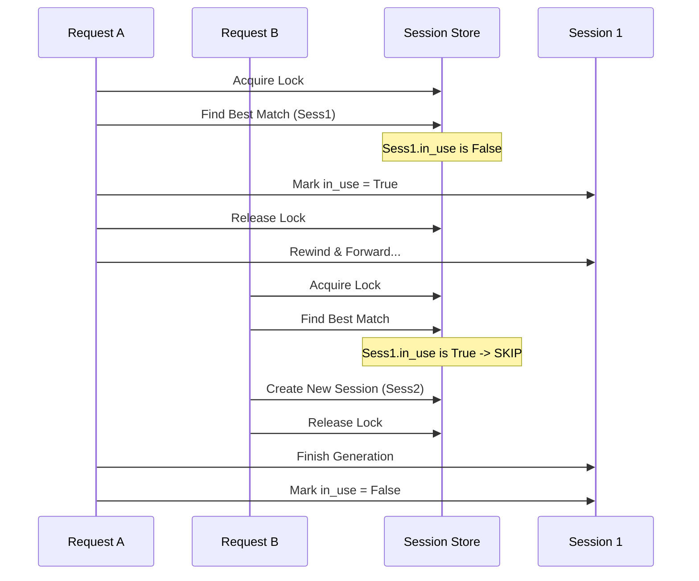

# Architecture Decision: KV Cache Concurrency Management

## 1. Problem Analysis
The current implementation of `server.py` allows multiple concurrent requests (handled via asyncio) to access and modify the same `SessionMeta` object and its underlying C++ KV Cache.

### Conflict Points
1.  **Smart Match Race Condition**:
    *   Request A finds Session S as the best match.
    *   Request A rewinds Session S to length L1.
    *   Request A yields control (await).
    *   Request B finds Session S as the best match (before A updates it or finishes).
    *   Request B rewinds Session S to length L2.
    *   Request A resumes and writes to Session S at the wrong position, overwriting B's data or causing memory corruption.
2.  **Session Store Mutation**:
    *   `get_session_for_request` iterates over `session_store`.
    *   If `max_sessions` is reached, it deletes an entry.
    *   If this happens concurrently with another iteration, it can raise `RuntimeError: dictionary changed size during iteration`.

## 2. Responsibility Boundary
The responsibility for managing concurrency lies within the **Server Layer (`server.py`)**, not the C++ Engine (`qwen2.cc`).

*   **Server Layer**: Manages the lifecycle and assignment of sessions. It acts as the "Resource Manager". It knows about "Requests" and "Users".
*   **Engine Layer**: Provides the mechanism (`create`, `destroy`, `rewind`, `forward`). It should remain stateless regarding "who" is using the session.

## 3. Proposed Solution
We implement a **Lock-based Reservation System** in `server.py`.

### Mechanisms
1.  **Global Store Lock (`store_lock`)**: Protects the `session_store` dictionary structure (add/remove keys) and ensures atomic selection of sessions.
2.  **Session Usage Flag (`in_use`)**: Each `SessionMeta` tracks whether it is currently assigned to an active request.
3.  **Atomic Allocation**:
    *   When a request arrives, acquire `store_lock`.
    *   Search for a session (ID match or Smart prefix match).
    *   **Crucial**: Skip any session where `in_use == True`.
    *   Mark selected session as `in_use = True`.
    *   Release `store_lock`.
4.  **Safe Release**:
    *   When request completes (or fails), set `in_use = False`.

### Sequence Diagram (Conceptual)

## 4. Implementation Details
*   Use `threading.Lock()` for the global store lock to be safe against both threaded and asyncio concurrency (since async runs in a thread).
*   Add `in_use` boolean field to `SessionMeta`.
*   Wrap session acquisition in a `try...finally` block in the main handler to ensure release.
