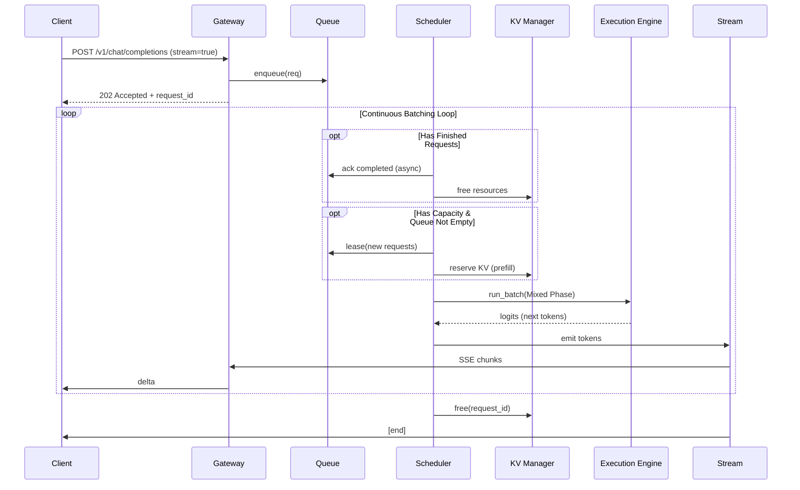

# Multi-Tenant LLM Inference Architecture Design

Version: 1.0
Scope: Multi-tenant LLM serving with continuous batching, KV-cache management, mixed prefill/decode, streaming I/O, and strict tenant isolation.

Assumptions:
- The README section referenced (README.md#L415-424) aligns with the slides: lightweight service layer, request queue, scheduler, KV cache per request, streaming outputs, and mixed prefill/decode via continuous batching.
- Update this document with exact README constraints once available.

## 1. High-Level Architecture

```mermaid
flowchart LR
  subgraph Clients
    U1[End Users / Apps]
    U2[Partner Services]
  end

  U1 -->|HTTP/mTLS| GW
  U2 -->|HTTP/mTLS| GW

  subgraph ControlPlane[Control Plane]
    TM[Tenant Manager]
    AM[AuthN/Z & RBAC]
    RM[Rate Limiter / Quotas]
    BM[Billing & Usage]
    CM[Config & Feature Flags]
  end

  subgraph DataPlane[Inference Data Plane]
    AG[API Endpoint\n(Stateless, lightweight)]
    RQ[Request Queue / Pool]
    SCH[Scheduler\n(continuous batching, PD-mix)]
    KVM[KV-Cache Manager\n(Quota-based, Contiguous)]
    subgraph Exec[Execution Engine]
      BR[Batch Router\n(iter-level batching)]
      KF[Fusable Kernels\nMLP/QKV/RMSNorm/RoPE]
      SA[Per-Request Ops\nKV concat & Self-Attn]
      MR[Model Runtime\n(TP/PP/DP, CUDA Graphs)]
    end
    STRM[Streamer\n(Server-Sent Events/GRPC)]
  end

  subgraph Infra[Shared Infra]
    MD[(Model Weights Store)]
    MDB[(Metadata DB)]
    AUD[Audit Log]
    OBS[Observability\n(Metrics/Tracing/Logs)]
  end

  GW[API Gateway] --> AM
  GW --> RM
  GW --> AG
  AM --> TM
  TM --> MDB
  RM --> MDB
  BM --> MDB

  AG -->|enqueue| RQ
  RQ --> SCH
  SCH <--> KVM
  SCH --> BR
  BR --> KF --> SA --> MR
  MR --> STRM
  STRM -->|token stream| GW --> U1
  MR --- MD
  OBS <-- Exec
  AUD <-- GW
```

Key interaction patterns:
- Lightweight service layer accepts authenticated requests, enqueues them, and streams results.
- Scheduler performs continuous batching across requests and mixes Prefill (multi-token) with Decode (single-token) iterations.
- Batchable ops (MLP, QKV Linear, RMSNorm, RoPE) are fused and executed cross-request; per-request ops (KV concat, self-attention score/softmax) isolate per sequence.
- Each request pins its own contiguous KV cache; KV Manager enforces per-tenant quotas.
- Security and tenancy enforced at gateway and scheduler levels.

## 2. Component Specifications

### 2.1 API Gateway and Endpoint (Stateless Service Layer)
- Responsibilities:
  - Authenticate, authorize, rate-limit.
  - Accept requests “随时到来”, enqueue, avoid heavy compute.
  - Stream outputs and handle disconnects/cancellation.
  - **Cache Affinity Routing**: Route requests with same `session_id` to the same instance (M2 Milestone).
- Interfaces (REST/JSON + SSE; optional gRPC):
  - POST /v1/chat/completions
  - POST /v1/completions
  - POST /v1/embeddings
  - POST /v1/batches (optional)
  - POST /v1/cancel/{request_id}
  - GET /v1/models
  - Admin: /v1/tenants, /v1/quotas, /v1/keys
- Request schema (superset):
  - tenant_id, api_key/jwt
  - model (name/revision)
  - input: messages[] or prompt, max_tokens, stop[], temperature, top_p, top_k, repetition_penalty
  - mode: prefill_only | decode | generate
  - priority, deadline_ms (optional)
  - stream: true/false
  - metadata: opaque dict
- Streaming:
  - SSE/GRPC with chunked tokens, usage, final summary.
  - Disconnect handling: resume/cancel idempotently.

Security controls:
- mTLS between edge and gateway; JWT (OIDC) or HMAC API keys per tenant.
- Per-tenant RBAC scopes (models, rate, max context).
- Request signing timestamp/nonce.

Scalability:
- Stateless pods; horizontal autoscaling on RPS and P95 TTFT.
- Zero heavy CPU work; backpressure via 429 and queue visibility.

### 2.2 Request Queue / Pool
- **Architecture**: Pluggable "Task Queue" model (Competing Consumers), not Pub/Sub.
  - *Why*: Supports pull-based leasing (`lease`) and reliable processing (`ack`/`nack`).
- Data structure:
  - Partitioned by model_id and tenant partition; inside, fair-queuing (Deficit Round Robin) to avoid head-of-line blocking (“短请求等待长请求”).
  - Tracks request phase: Prefill vs Decode; iteration cursor.
- APIs (Abstract Interface `IQueueService`):
  - `enqueue(topic, message) -> id`
  - `lease(topic, count, timeout) -> list[message]`
  - `ack(topic, ids)`
  - `nack(topic, ids)`
- Implementations:
  1.  **In-Memory (Single Node)**:
      - Uses `asyncio.PriorityQueue` per topic.
      - Background reaper task for visibility timeout (lease expiration).
  2.  **Distributed (Kafka Adapter)**:
      - **Topic Strategy**: `llm-req-{model_family}`.
      - **Lease**: Maps to Kafka Consumer Group `poll()`. Buffers records locally to satisfy exact count.
      - **Ack**: Maps to manual offset commit.
      - **Nack**: Sends failed messages to a "Dead Letter Topic" or retry topic, then commits offset to move forward.
- Persistence:
  - In-memory with WAL for HA, or Redis/RabbitMQ; shardable by model.

### 2.3 Scheduler (Continuous & Adaptive Batching)
- **Core Functionality**:
  - Continuous batching with iteration-level scheduling (Orca-style).
  - **Adaptive Batching (Clipper-style)**:
    - **Dynamic Batch Size (AIMD)**: Adjusts batch size limit based on real-time latency feedback.
      - *Additive Increase*: `batch_size += 1` after 3 consecutive successful iterations (latency < SLO).
      - *Multiplicative Decrease*: `batch_size *= 0.9` immediately upon SLO violation.
      - Constraint: `batch_size < SLO` (latency constrained).
    - **Delayed Batching**:
      - If queue length < `current_batch_size`, wait up to `y` ms (default 5ms) to accumulate requests.
      - Improves throughput at cost of slight latency increase (within SLO).
    - **Adaptive Tuning**:
      - Online parameter tuning using EMA (Exponential Moving Average) of latency.
      - Updates every 1000 inferences or 30s.

- Algorithms:
  - Token-level round-robin across tenants.
  - Padding minimization via compact sequences.
  - Admission control: KV quota, model residency.

- Outputs to Execution Engine:
  - Batch descriptors: tensors, attention masks, RoPE offsets.
  - Per-request op plan.

### 2.3.1 Adaptive Batching Configuration
| Parameter | Default | Description |
|-----------|---------|-------------|
| `slo_ms` | 200 | Target P99 latency for an iteration. |
| `batch_wait_ms` | 5 | Max wait time for delayed batching. |
| `aimd_additive_step` | 1 | Increase step size. |
| `aimd_mult_factor` | 0.9 | Decrease factor (0.0-1.0). |
| `ema_alpha` | 0.1 | Smoothing factor for latency stats. |

### 2.4 KV-Cache Manager
- Requirements:
  - “每个请求需要锁定一份 KV Cache (Contiguous Tensor)”.
  - Per-tenant quotas and isolation; OOM prevention.
  - **Future Work**: Paged KV design (M3) to solve fragmentation.
- APIs:
  - reserve(tenant_id, max_tokens, dtype) -> tensor_slice
  - free(request_id)
  - compact(…) (Optional for contiguous memory defragmentation)
- Implementation:
  - CUDA-aware allocator; supports FP16/BF16/FP8 KV.
  - Pre-allocated large tensor pool sliced per request.

### 2.5 Execution Engine and Model Runtime
- Batch Router:
  - Splits plan into batchable vs per-request ops per layer; aligns with figure: Split → QKV Linear → Attn → Merge → AttnOut.
  - **M1 Milestone**: Supports Continuous Batching with contiguous memory (irregular batch shapes).
- Fusable Kernels (batchable):
  - MLP, QKV Linear, RMSNorm: Token-independent ops; support flattened input `[Total_Tokens, Hidden_Dim]`.
  - RoPE (Rotary Embeddings): Must support **Ragged Batch** via `position_ids` tensor (different positions per request in batch).
  - CUDA Graphs capture for stable iteration latency.
- Per-Request Ops:
  - KV concat: Append new tokens to contiguous per-request buffers.
  - Self-Attention: Must support **Variable Length** via `cu_seqlens` (Cumulative Sequence Lengths) for FlashAttention/SDPA.
- Runtime:
  - Supports TP/PP/DP with NCCL; model weights loaded once per shard from Model Store.
  - Supports MIG partitioning; one runtime per MIG slice.
- APIs:
  - run_batch(plan) -> token logits
  - load_model(model_id)
  - unload_model(model_id) (LSRU policy)
- Disconnection/abort:
  - Cooperative cancellation checks per iteration.

### 2.6 Streamer
- Converts logits to tokens per request with sampler config.
- Emits incremental deltas; handles “断联处理” by halting and freeing allocations.
- Supports deterministic (greedy) and stochastic (temperature, top_p).

### 2.7 Control Plane
*(See detailed specification in `docs/multi-tenant/control-plane-design.md`)*

- Tenant Manager:
  - CRUD tenants, API keys, quotas (rate, context, KV pool slice).
- AuthN/Z:
  - **Strategy**: API Key based authentication (M1); OAuth2/OIDC for SaaS frontend (M2, via Clerk/NextAuth).
  - **Middleware**: Validates `Authorization: Bearer <sk-key>` or JWT.
  - **Context Injection**: Injects `X-Tenant-ID` and `X-User-ID` headers for downstream services.
  - OIDC/JWT validation; HMAC for server-server; RBAC policy engine (OPA).
- Rate Limiter:
  - Global and per-tenant limits; burst + steady-state tokens/s.
- Billing/Usage:
  - Token accounting, model-time, GPU-seconds.
- Config:
  - Feature flags per tenant/model; safe rollout.

### 2.8 Storage and Observability
- Model Weights Store: S3-compatible with SHA256 pinning; local cache on nodes.
- Metadata DB: Postgres for tenants, usage, keys.
- Audit Log: WORM storage, append-only.
- Observability: Prometheus metrics, OpenTelemetry traces, structured logs.

Deployment topology:
- Kubernetes with GPU nodes.
- Node pools per model family; MIG slices for isolation.
- One Inference DaemonSet per node exposing runtime, with multiple worker pods sharing GPUs via MIG.
- API Gateway and Control Plane deployed as stateless microservices with HPA.
- Optional multi-region with global load-balancer.

## 3. Tenant-Specific vs Shared Resources

- Shared:
  - Model weights (read-only), execution kernels, gateway, scheduler logic.
  - Observability stack, audit pipeline.
- Tenant-specific (logical or physical isolation):
  - API keys, quotas, RBAC policies (DB schema or table partition per tenant).
  - Request queues (virtual lanes) and fair-share weights.
  - KV-Cache quotas and pools (hard caps per tenant).
  - Rate limits and max concurrent requests.
  - Usage/billing records.

Isolation levels and rationale:
- Compute:
  - Primary: MIG partitions for strong isolation where required; else cgroups+MPS with scheduler fairness.
  - Preemption/cancellation at iteration boundaries.
- Memory:
  - KV cache hard partitioned by tenant quotas (Contiguous, M1); guard pages to prevent overflow.
  - **Future Work (M3)**: Paged KV for fine-grained sharing.
- Storage:
  - Metadata per-tenant schema; audit uses tenant tags.
  - Model store shared, integrity-checked.
- Network:
  - mTLS and per-tenant service accounts/NSG rules for private endpoints.

## 4. Security Architecture

Authentication:
- **API Key (M1)**: `Authorization: Bearer sk-<random>` for programmatic access.
- **Frontend Auth (M2)**: OAuth2/OIDC via third-party provider (e.g., Clerk/NextAuth) for user login.
- **Internal**: mTLS between components (SPIFFE/SPIRE).
- **Tenant Context**: Gateway validates credentials and propagates `X-Tenant-ID` to backend services.

Authorization:
- RBAC policies per tenant (OPA/Rego): allowed models, max context, max rate, max batch priority.
- Admin endpoints restricted to tenant admins; all access audited.

Encryption:
- In transit: TLS 1.3 everywhere.
- At rest: S3 SSE-KMS for models; Postgres TDE; logs encrypted.
- KV cache: transient in GPU memory; optional memory scrubbing on free.

Audit and Compliance:
- Every request lifecycle event logged with tenant_id, model_id, parameters, result hashes, cancellation, and allocator actions.
- Mappings:
  - ISO 27001 A.9 (access control), A.12 (operations), A.14 (system acquisition).
  - SOC 2 CC6.x (logical access), CC7.x (change management), CC8.x (monitoring).
- Data residency and deletion:
  - No user prompts stored by default; opt-in retention with TTLs.

Incident response:
- Anomaly detection on usage spikes and KV OOM rates.
- Kill-switch to disable tenant keys.

## 5. Performance and Scalability Requirements (SLAs)

Workload assumptions:
- Context up to 8k tokens; generation up to 1k tokens (configurable).
- Models: 7B–70B with TP/PP.

SLA targets (per request, steady-state under allocated quota):
- Time To First Token (TTFT):
  - P50 ≤ 400 ms (7B on A100/MIG), P95 ≤ 1,000 ms with cached model.
- Time Between Tokens (TBT) during decode:
  - P50 ≤ 15 ms/token, P95 ≤ 35 ms/token (7B baseline), scales with batch size.
- Throughput:
  - ≥ 1,500 tokens/s/GPU (7B BF16) under mixed PD workloads; larger models scale proportionally.
- Queueing fairness:
  - Short requests P95 wait time ≤ 2× median wait time under mixed load (anti-HoL).
- Availability:
  - ≥ 99.9% monthly for public API.
- Cold-load penalty:
  - Model load time hidden via pre-warm; SLO breach budget < 1% requests.

Resource limits and quotas (per tenant defaults; adjustable):
- Max concurrent requests: 200
- KV cache cap: 8 GB per GPU slice or 20% of slice, whichever smaller.
- Max context length: 8k (higher on allowlist).
- RPS/token rate: 500 req/min or 5k tok/s.

Scalability mechanisms:
- Horizontal autoscaling on:
  - Queue depth, TTFT P95, tokens/s per GPU.
- Model sharding:
  - Scale-out with DP; cross-node NCCL with tuned topology.
- CUDA optimizations:
  - Fused MLP/QKV/RMSNorm; RoPE vectorized; FP8 where supported.
  - CUDA Graphs for steady decode loops; pinned host memory for transfers.
- Memory efficiency:
  - Contiguous KV cache (M1); activation checkpointing for long prefill.
  - **Future Work (M3)**: Paged KV for fine-grained sharing.
- Contention avoidance:
  - Batch-size caps to limit latency spikes; DRR with per-tenant quantum.

## 6. Detailed APIs and Data Models

### Request Object (JSON)
- id: string (server-assigned)
- tenant_id: string
- model: string
- input: {messages[]|prompt}
- sampling: {temperature, top_p, top_k, repetition_penalty, stop[]}
- limits: {max_tokens, max_time_ms}
- mode: prefill|decode|generate
- priority: int (bounded by policy)
- stream: bool
- metadata: object

### Stream Event (SSE)
- event: token|usage|end|error
- data: {id, index, token, logprob?, finish_reason?}

### Admin
- POST /v1/tenants {name, quotas}
- POST /v1/keys {tenant_id, scopes}
- PUT /v1/tenants/{id}/quotas
- GET /v1/usage?tenant_id&range
- GET /v1/audit?tenant_id&range

## 7. Scheduler and Execution Sequence



## 8. Deployment and Topology

```mermaid
graph TD
  subgraph Region
    LB[Global LB]
    LB-->EGW[Edge API Gateway]
    EGW-->APIPods[API Pods (HPA)]
    APIPods-->RQSvc[Request Queue Svc]
    APIPods-->Ctrl[Control Plane]
    Ctrl-->PG[(Postgres)]
    Ctrl-->S3[(S3 Model Store)]
    subgraph GPUCluster[GPU Node Pool]
      Node1[MIG Node]-->|MIG A| InfA[Inference Worker A]
      Node1-->|MIG B| InfB[Inference Worker B]
      Node2[MIG Node]-->|MIG C| InfC[Inference Worker C]
    end
    RQSvc-->InfA
    RQSvc-->InfB
    RQSvc-->InfC
    S3-->InfA
    S3-->InfB
    S3-->InfC
    InfA-->Obs[Prom/OTel]
    EGW-->Audit[Audit Log]
  end
```

## 9. Compliance and Data Handling

- Default no-storage of prompts/completions; ephemeral processing.
- Opt-in retention with per-tenant TTL and encryption keys.
- Right-to-erasure supported by metadata-only usage logs.

## 10. Testing and SLO Monitoring

- Synthetic load with mixed Prefill/Decode (PD-mix) to verify anti-HoL.
- SLO dashboards:
  - TTFT and TBT percentiles by tenant/model.
  - Queue wait time distributions.
  - KV allocation failure rate (< 0.1%).
  - GPU utilization and achieved tokens/s.
- Error budgets and auto-throttle policies.

## 11. Change Management

- Canary rollouts per tenant via feature flags.
- Model revision pinning and safe rollback.
- Schema migrations backward-compatible; strong API versioning (/v1, /v2).

## 12. Open Items

- Confirm README#L415-424 specifics to tune quotas and defaults.
- Finalize FP8 adoption matrix per GPU generation.
- Add RAG endpoints if required by product scope.
- **Future Work (M3)**: Implement PagedAttention and BlockManager for fine-grained KV memory management and advanced prefix caching.

End of document.
