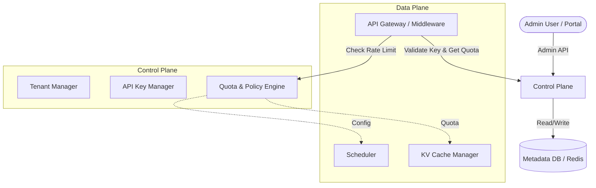
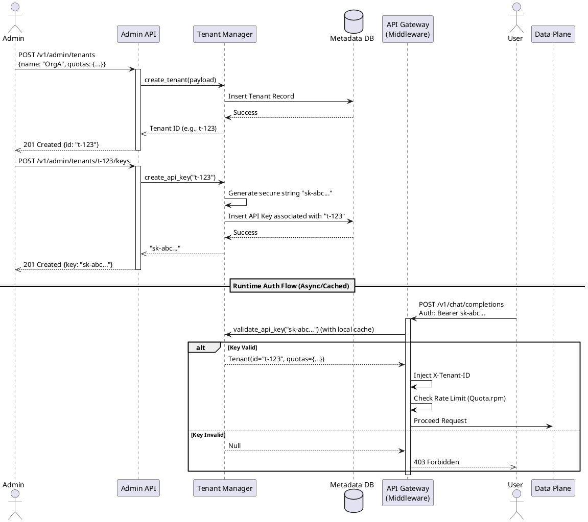

# Control Plane Design Specification

## 1. 功能描述 (Functional Description)

Control Plane 是多租户大语言模型推理系统（LLM Inference System）的核心管理中枢，负责在无状态的 Data Plane（推理数据面）之上，构建安全、隔离、可度量的多租户运行环境。

**核心职责：**
1. **租户生命周期管理**：提供租户的创建、更新、查询、删除（CRUD）能力，并管理每个租户关联的 API Key（生成、验证、吊销）。
2. **策略下发与配额管理**：集中管理租户级别的配额限制（如 `requests_per_minute`、`max_tokens_per_day`、`kv_pool_slice`），并下发给 Data Plane（通过 API Gateway 的 Auth Middleware 拦截并执行）。
3. **配置编排**：管理租户级或模型级的 Feature Flags（如特定租户是否允许使用高优先级队列或特定长上下文模型）。
4. **集群状态与指标聚合**：通过 Observability 模块聚合各个租户的调用指标、计费数据（Token 消耗、请求次数），支持后续的 Billing 模块。

**边界上下文图：**


---

## 2. 接口定义 (Interface Specifications)

Control Plane 对外提供基于 RESTful 的 Admin API，用于租户与策略管理。

### OpenAPI 3.0 规范片段
```yaml
openapi: 3.0.0
info:
  title: LLAISYS Control Plane API
  version: 1.0.0
paths:
  /v1/admin/tenants:
    post:
      summary: 创建新租户 (Create Tenant)
      security:
        - AdminAuth: []
      requestBody:
        required: true
        content:
          application/json:
            schema:
              type: object
              required: [name]
              properties:
                name:
                  type: string
                quotas:
                  $ref: '#/components/schemas/Quota'
      responses:
        '201':
          description: Tenant created successfully
          content:
            application/json:
              schema:
                $ref: '#/components/schemas/Tenant'
        '409':
          description: Tenant already exists (Idempotency error)

  /v1/admin/tenants/{tenant_id}/keys:
    post:
      summary: 为租户生成 API Key (Generate API Key)
      parameters:
        - in: path
          name: tenant_id
          required: true
          schema:
            type: string
      responses:
        '201':
          description: API Key generated
          content:
            application/json:
              schema:
                type: object
                properties:
                  key:
                    type: string
                    example: "sk-xxxxxxxxx"

components:
  schemas:
    Quota:
      type: object
      properties:
        requests_per_minute:
          type: integer
          default: 60
        max_tokens_per_day:
          type: integer
          default: 100000
        kv_pool_slice:
          type: integer
          default: 1024
    Tenant:
      type: object
      properties:
        id:
          type: string
        name:
          type: string
        quotas:
          $ref: '#/components/schemas/Quota'
        created_at:
          type: string
          format: date-time
  securitySchemes:
    AdminAuth:
      type: http
      scheme: bearer
      bearerFormat: JWT
```

**幂等性保证：**
- `POST /v1/admin/tenants` 支持 `Idempotency-Key` HTTP Header。
- 如果请求重试带有相同的 Idempotency-Key，系统返回相同的 Tenant ID 而不重复创建。

**鉴权方式：**
- Admin API 使用独立的 JWT 鉴权（内部 RBAC），与普通的租户 API Key 隔离。

---

## 3. 时序图 (Sequence Diagrams)

### 3.1 租户创建与配置下发


---

## 4. 配置示例 (Configuration Examples)

### Helm Values 示例 (`values.yaml`)
```yaml
controlPlane:
  replicaCount: 2
  resources:
    limits:
      cpu: "500m"
      memory: "512Mi"
    requests:
      cpu: "100m"
      memory: "128Mi"
  hpa:
    enabled: true
    minReplicas: 2
    maxReplicas: 5
    targetCPUUtilizationPercentage: 80
  config:
    logLevel: "INFO"
    cacheTTLSeconds: 300 # API Key 验证的本地缓存时间
    
tenantDefaults:
  rateLimit:
    requestsPerMinute: 60
    burst: 10
  quotas:
    maxTokensPerDay: 1000000
```

### CRD 样例 (Kubernetes Custom Resource)
通过 GitOps 管理租户基线配置：
```yaml
apiVersion: llaisys.ai/v1alpha1
kind: TenantPolicy
metadata:
  name: premium-tier-policy
spec:
  tier: premium
  quotas:
    requests_per_minute: 1000
    kv_pool_slice: 4096 # MB
  features:
    allow_long_context: true
    priority_queue: true
```

---

## 5. 测试策略 (Testing Strategy)

### 5.1 单元测试 (Unit Testing)
- **覆盖率目标**：`app/services/tenant_manager.py` 和 `app/services/rate_limiter.py` 核心逻辑代码覆盖率 ≥ 80%。
- **核心用例**：
  - **并发创建冲突**：模拟并发生成相同前缀的 API Key，确保唯一性约束和重试机制（降级路径）。
  - **缓存一致性**：测试 API Key 被 `revoke_api_key` 后，RateLimiter 和 Middleware 能否立即或在 TTL 内阻断请求。
  - **限速器（Token Bucket）边界**：测试一秒内突发请求（Burst）是否按预期允许，随后超出部分是否严格返回 429。

### 5.2 集成测试 (Integration Testing)
- **工具链**：使用 `Kind` (Kubernetes in Docker) + `kuttl` (KUbernetes Test TooL)。
- **测试用例**：
  1. 部署 Control Plane Helm Chart。
  2. 提交 `TenantPolicy` CR，验证 Operator 是否在 Metadata DB 中正确同步了租户信息。
  3. 通过 API Gateway 发起请求，验证限速策略生效。
- **自动化**：提供 `make test-integration`，一键拉起 Kind 集群、部署应用并运行断言。

### 5.3 性能基准 (Performance Benchmarking)
- **场景**：1, 5, 10 个租户并发向 API Gateway 注册并立即发起满载推理请求。
- **指标采集**：
  - Control Plane API (租户创建) P99 延迟 < 50ms。
  - Rate Limiter 检查延迟 P99 < 2ms。
  - Control Plane Pod CPU < 300m，Memory < 200Mi。
- **交付物**：通过 Locust / K6 输出压测报告，并提供 Grafana Dashboard JSON，包含 "Tenant Creation Latency" 和 "Rate Limiter Drops" 面板。