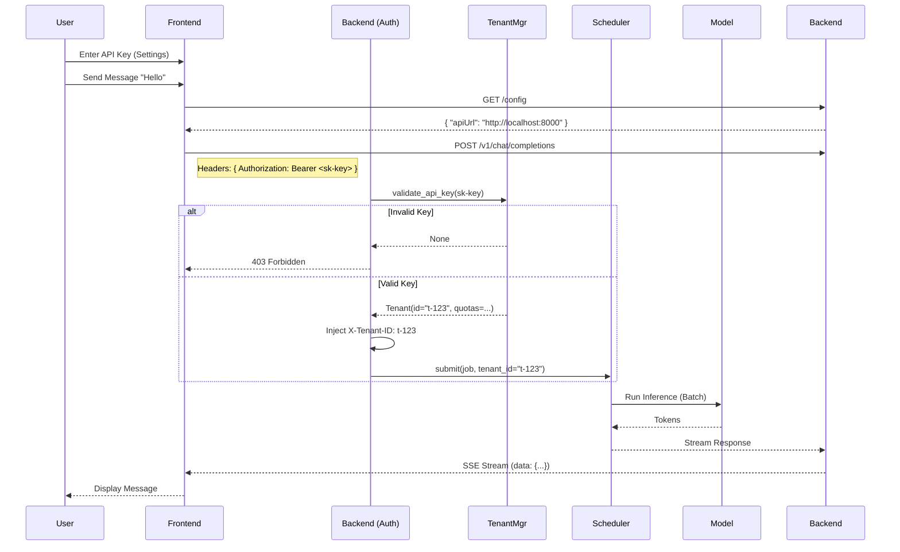

# End-to-End Implementation Flow

## 1. Overview
This document describes the complete end-to-end flow for the Multi-Tenant LLM Inference System ("llaisys"), integrating the React frontend with the FastAPI backend services. The system implements strict tenant isolation through API Key authentication and Context Injection.

## 2. Architecture Components
*   **Frontend**: React application (Vite) providing a chat interface and settings for API Key management.
*   **API Gateway / Backend**: FastAPI application (`app/main.py`) handling:
    *   CORS and Configuration (`/config`)
    *   Authentication & Tenant Context (`AuthMiddleware`)
    *   Chat Completions (`/v1/chat/completions`)
*   **Control Plane**:
    *   `TenantManager`: Validates API keys and resolves Tenant IDs.
    *   `RateLimiter`: Enforces per-tenant quotas.
*   **Data Plane**:
    *   `Scheduler`: Manages request queues and continuous batching.
    *   `ModelService`: Executes inference.

## 3. Sequence Diagram



## 4. API Integration Specifications

### 4.1 Configuration Endpoint
*   **URL**: `GET /config`
*   **Response**:
    ```json
    {
        "apiUrl": "http://localhost:8000"
    }
    ```
*   **Purpose**: Allows frontend to discover backend URL dynamically (e.g., in containerized envs).

### 4.2 Chat Completions Endpoint
*   **URL**: `POST /v1/chat/completions`
*   **Headers**:
    *   `Authorization`: `Bearer <api-key>` (Required for Production)
    *   `x-tenant-id`: `<tenant-id>` (Optional bypass for Dev/Test if no key provided)
*   **Body**:
    ```json
    {
        "model": "qwen2",
        "messages": [{"role": "user", "content": "Hello"}],
        "stream": true
    }
    ```

## 5. Tenant Isolation Mechanisms
1.  **Authentication**: `AuthMiddleware` intercepts every request. If an API Key is present, it validates against `TenantManager`.
2.  **Context Injection**: On successful validation, the `AuthMiddleware` passes the request downstream. (Future enhancement: inject `request.state.tenant`).
3.  **Data Isolation**: `SessionDAO` and `RateLimiter` use `tenant_id` to partition data and counters.
    *   Sessions are stored with `tenant_id`.
    *   Rate limits are checked per `tenant_id`.

## 6. Comprehensive Testing
### 6.1 Unit Tests
*   `test/chatbot/backend/test_auth_middleware.py`: Verifies API Key validation and 401/403 responses.
*   `test/chatbot/backend/test_control_plane.py`: Verifies Tenant creation and API Key generation.

### 6.2 Integration Tests
*   `test/chatbot/backend/test_integration_flow.py`: Verifies the full chat flow.
*   **Manual Verification**:
    1.  Start Backend: `uvicorn src.chatbot.backend.app.main:app --port 8000`
    2.  Start Frontend: `npm run dev`
    3.  Open Browser: `http://localhost:5173`
    4.  Enter Settings -> API Key (obtain one via `TenantManager` or use dev bypass).
    5.  Chat and verify response.

## 7. Deployment Instructions

### Backend
```bash
# Install dependencies
pip install -r src/chatbot/backend/requirements.txt

# Run Server (Modular)
uvicorn src.chatbot.backend.app.main:app --host 0.0.0.0 --port 8000 --reload
```

### Frontend
```bash
cd src/chatbot/frontend
npm install
npm run dev
```

### Tenant Setup (Script)
To generate an API key for testing:
```python
import asyncio
from src.chatbot.backend.app.services.tenant_manager import TenantManager
from src.chatbot/backend/app/models/tenant import TenantCreate

async def setup():
    tm = TenantManager()
    t = await tm.create_tenant(TenantCreate(name="Demo Tenant"))
    key = await tm.create_api_key(t.id)
    print(f"Tenant ID: {t.id}")
    print(f"API Key: {key}")

asyncio.run(setup())
```
