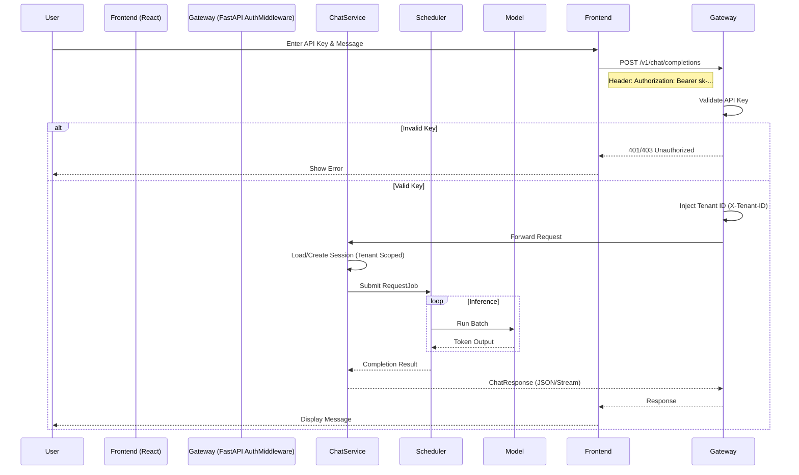

# End-to-End Implementation Guide: Multi-Tenant LLM Chat System

## 1. Overview
This guide describes the end-to-end flow of the Multi-Tenant LLM Chat System, integrating the React frontend with the FastAPI backend, secured by API Key authentication and tenant isolation.

## 2. Architecture & Flow

The system follows the architecture defined in `architecture-design.md`.

### Sequence Diagram



## 3. API Specifications

### POST /v1/chat/completions

**Headers:**
- `Content-Type`: `application/json`
- `Authorization`: `Bearer <sk-api-key>`

**Body:**
```json
{
  "model": "qwen2",
  "messages": [
    {"role": "user", "content": "Hello"}
  ],
  "temperature": 0.7,
  "stream": true,
  "session_id": "optional-session-id"
}
```

**Response (Stream):**
Server-Sent Events (SSE) with chunks conforming to OpenAI format.

## 4. Tenant Isolation Mechanism

1.  **Authentication**: `AuthMiddleware` intercepts all requests. It looks up the `sk-key` in `TenantManager` to resolve the `tenant_id`.
2.  **Context Injection**: The resolved `tenant_id` is stored in `request.state.tenant_id`.
3.  **Service Isolation**:
    -   **SessionDAO**: Stores chat history partitioned by `tenant_id`.
    -   **RateLimiter**: Enforces limits based on `tenant_id`.
    -   **Scheduler**: (Future) Fair queuing based on `tenant_id`.

## 5. Deployment & Usage

### Prerequisites
- Python 3.8+
- Node.js 16+

### Step 1: Start Backend

1.  Navigate to `src/chatbot/backend`.
2.  Install dependencies:
    ```bash
    pip install -r requirements.txt
    ```
3.  Start the server:
    ```bash
    python -m app.main
    # OR if using uvicorn directly
    uvicorn app.main:app --reload --port 8000
    ```

### Step 2: Create a Tenant & API Key

Since there is no Admin UI yet, use a script or Python shell to generate a key.

```python
# scripts/create_tenant.py
import asyncio
from chatbot.backend.app.dependencies import tenant_manager
from chatbot.backend.app.models.tenant import TenantCreate

async def main():
    tenant = await tenant_manager.create_tenant(TenantCreate(name="Demo Tenant"))
    key = await tenant_manager.create_api_key(tenant.id)
    print(f"Tenant ID: {tenant.id}")
    print(f"API Key: {key}")

if __name__ == "__main__":
    asyncio.run(main())
```

### Step 3: Start Frontend

1.  Navigate to `src/chatbot/frontend`.
2.  Install dependencies:
    ```bash
    npm install
    ```
3.  Start Dev Server:
    ```bash
    npm run dev
    ```
4.  Open browser (usually `http://localhost:5173`).

### Step 4: Interact

1.  Copy the API Key generated in Step 2.
2.  Paste it into the "API Key" input field in the Navbar.
3.  Start chatting!

## 6. Testing

### Backend Tests
Run the pytest suite to verify Auth Middleware and Services.

```bash
PYTHONPATH=src pytest test/chatbot/backend/test_auth_middleware.py
```

### Frontend Integration
The frontend automatically attaches the API Key from the input field to the `Authorization` header. Check the Network tab in DevTools to verify.
